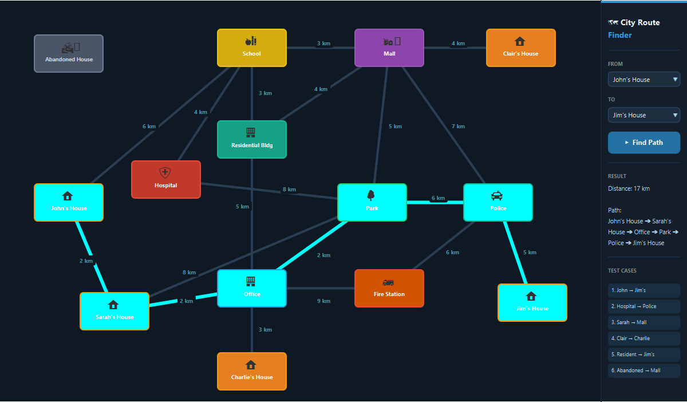

# 🗺️ City Route Finder - Data Structures Mini Project

An interactive desktop application built with **Java** and **JavaFX** that visualizes **Dijkstra's Shortest Path Algorithm** on an interconnected city map graph.

---

## 📌 Feature Summary & Demo



- **Interactive Pathfinding**: Select any starting location and destination to compute the optimal route with total distance in kilometers and step-by-step path sequence (`Start ➔ ... ➔ Destination`).
- **Dynamic Route Highlighting**: The computed shortest path illuminates in a bright, vibrant cyan (`CYAN`) across both nodes and roads.
- **Dark-Themed Modern UI**: High-contrast JavaFX canvas with distinct color-coded buildings, customized ChoiceBoxes, and clean, non-overlapping road labels.
- **Special Graph Topologies**:
  - **🏚️ Abandoned House**: An isolated node with no road connections, demonstrating unreachable state handling (*"No path found"*).
  - **🏠 Clair's House**: A residential house connected exclusively to the Mall.
  - **🏠 Charlie's House**: A residential house connected exclusively to the Office.
  - **🏢 Residential Building**: A central multi-connected hub connected to the Mall, School, and Office.
- **6 Preset Test Cases**: Instant one-click demonstrations in the sidebar:
  1. `John's House ➔ Jim's House` (Longest cross-map route across the city)
  2. `Hospital ➔ Police` (Cross-map service and emergency route)
  3. `Sarah's House ➔ Mall` (Shopping route)
  4. `Clair's House ➔ Charlie's House` (Traversing across newly connected residential nodes)
  5. `Residential Building ➔ Jim's House` (Route initiating from the central residential hub)
  6. `Abandoned House ➔ Mall` (Demonstrates isolated node with no path found)

---

## ⚡ Algorithm & Time Complexity

> **"Implemented using a PriorityQueue, giving Dijkstra's Algorithm a time complexity of $O((V + E) \log V)$, ensuring optimal performance even if the city map expands."**

### Complexity Analysis

- **Time Complexity**: **$\mathcal{O}((V + E) \log V)$**
  - **Vertices ($V$)**: Every building/location is inserted into the min-heap priority queue at most once ($\mathcal{O}(V \log V)$).
  - **Edges ($E$)**: Edge relaxation is performed for each adjacent road. Updating or inserting adjacent vertex distances into the priority queue takes $\mathcal{O}(\log V)$ per edge, totaling $\mathcal{O}(E \log V)$.
  - **Combined**: $\mathcal{O}((V + E) \log V)$ guarantees fast path computation even as additional city blocks and roads are added.
- **Space Complexity**: **$\mathcal{O}(V + E)$**
  - Adjacency list representation stores all $V$ vertices and $2E$ bidirectional edges.
  - Auxiliary distance map (`dist`), parent map (`parent`), and min-heap priority queue each require $\mathcal{O}(V)$ memory.

---

## 🛠️ Tech Stack & Architecture

- **Language**: Java 11+
- **GUI Framework**: JavaFX (Controls & FXML)
- **Build Tool**: Apache Maven
- **Core Algorithm**: Dijkstra's Algorithm with Min-Heap Priority Queue

### Key Files

| File | Description |
|---|---|
| [`CityGraph.java`](src/main/java/com/example/CityGraph.java) | Adjacency list representation of the city graph, vertices, and weighted road edges |
| [`ShortPath.java`](src/main/java/com/example/ShortPath.java) | Dijkstra's shortest path algorithm implementation using `java.util.PriorityQueue` |
| [`CityController.java`](src/main/java/com/example/CityController.java) | Controller managing UI events, path triggers, cyan visual highlights, resets, and preset test cases |
| [`App.java`](src/main/java/com/example/App.java) | JavaFX Application entry point |
| [`primary.fxml`](src/main/resources/com/example/primary.fxml) | FXML layout definition for the map canvas and sidebar panel |
| [`style.css`](src/main/resources/com/example/style.css) | Custom styling for the dark theme, context menus, and controls |
| [`screenshot.png`](screenshot.png) | UI screenshot showcasing active route highlighting and clean layout |

---

## 🚀 Getting Started

### Prerequisites

- **Java Development Kit (JDK)**: Version 11 or higher
- **Apache Maven**: Version 3.6 or higher

### Installation & Run

1. **Clone the repository**:
   ```bash
   git clone https://github.com/Amaanstilcodes/DsMiniProject.git
   cd DsMiniProject
   ```

2. **Compile the project**:
   ```bash
   mvn clean compile
   ```

3. **Launch the application**:
   ```bash
   mvn javafx:run
   ```

---

## 🧪 Graph Layout

```
Abandoned House (Isolated)

School (380, 50)  ==== 3 km ====  Mall (620, 50)  ==== 4 km ====  Clair's House (850, 50)
     ||                                 ||
    3 km                               4 km
     ||                                 ||
Residential Bldg (380, 210) ============//
     ||
    5 km
     ||
   Office (380, 470)  ==== 9 km ====  Fire Station (620, 470)
     ||                                       \\ 6 km
    3 km                                       \\
     ||                                         Police (810, 320) ==== 5 km ==== Jim's House (870, 495)
Charlie's House (380, 615)
```

---

## 📄 License

This project is created for educational and academic demonstration purposes as part of the Data Structures course curriculum.
